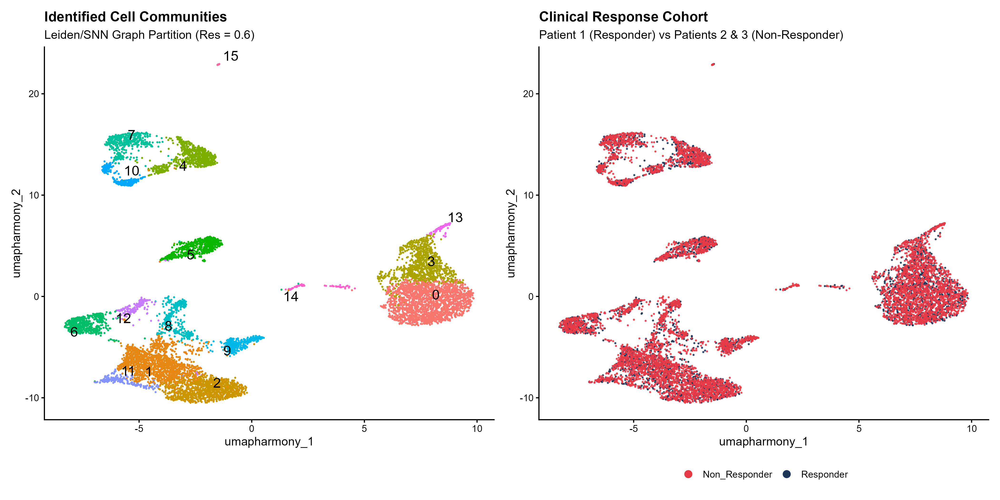
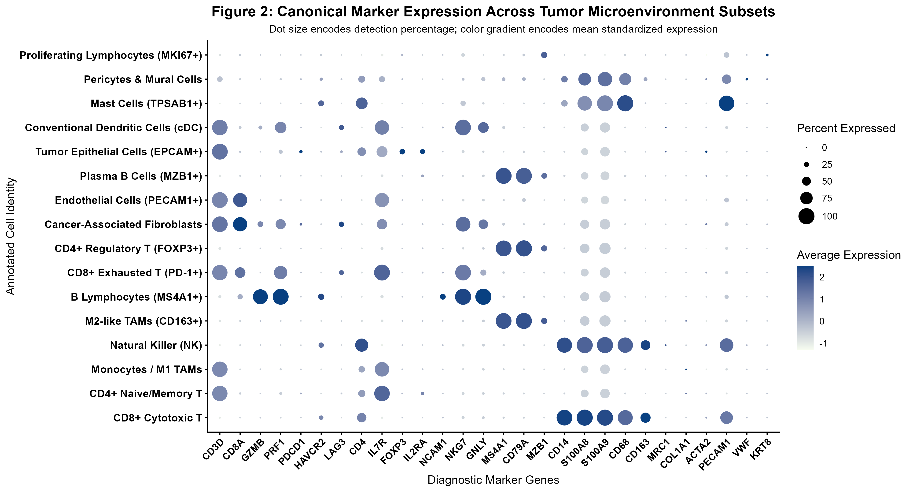
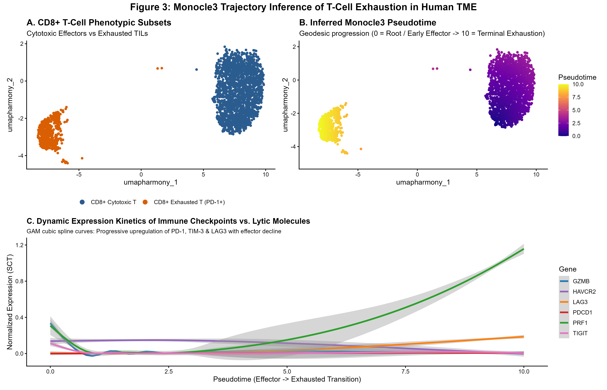
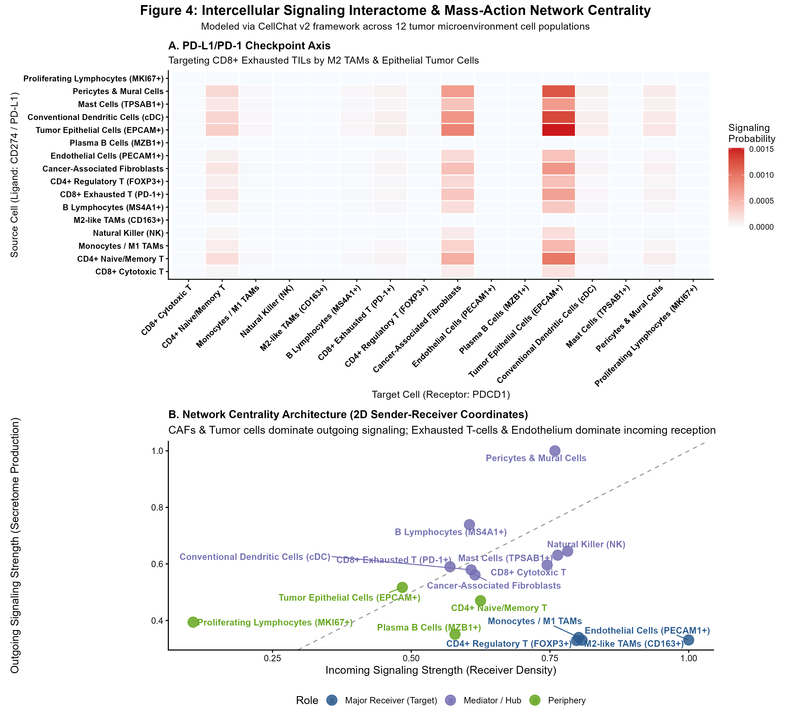
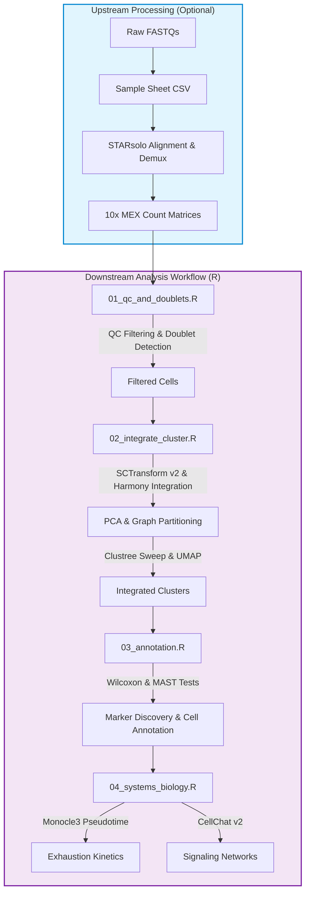

# Tumor Microenvironment Single-Cell RNA-Seq Atlas (TME-scAtlas)

[](https://www.nextflow.io/)
[](https://satijalab.org/seurat/)
[](https://hub.docker.com/)
[](LICENSE)

An end-to-end single-cell RNA-seq pipeline designed to characterize cellular heterogeneity, continuous T-cell exhaustion dynamics, and cell-cell communication networks across clinical responder and non-responder cohorts in the tumor microenvironment (TME).

---

## Table of Contents
1. [Overview](#overview)
2. [Cohort & Experimental Design](#cohort--experimental-design)
3. [Key Biological Findings](#key-biological-findings)
   - [Figure 1: Integrated TME Landscape](#figure-1-integrated-tme-landscape)
   - [Figure 2: Lineage Marker Characterization](#figure-2-lineage-marker-characterization)
   - [Figure 3: CD8+ T-Cell Exhaustion Pseudotime Trajectory](#figure-3-cd8-t-cell-exhaustion-pseudotime-trajectory)
   - [Figure 4: Intercellular Interactome & Network Centrality](#figure-4-intercellular-interactome--network-centrality)
4. [Pipeline Architecture](#pipeline-architecture)
5. [Methodological Rationale](#methodological-rationale)
6. [Repository Structure](#repository-structure)
7. [Getting Started & Reproducibility](#getting-started--reproducibility)
8. [Author & Contact](#author--contact)

---

## Overview

Solid tumor progression and variable response to immune checkpoint blockade (ICB) depend on complex cellular interactions between malignant cells, infiltrating lymphocytes, and the surrounding stroma. 

This repository implements a modular workflow connecting raw count quantification with downstream systems biology:

- **Cohort Profiling:** Transcriptomic analysis of **9,619 high-quality single cells** across 33,538 genes from patient biopsies representing distinct ICB response outcomes (`patient1_responder`, `patient2_non_responder`, `patient3_non_responder`).
- **Sample Integration:** Sample-layer decoupled **SCTransform v2** normalization coupled with **Harmony** integration to correct patient-specific batch effects while preserving biological lineage divergence.
- **Trajectory Modeling:** Unsupervised pseudotime inference mapping the transition from early effector CD8+ T cells to dysfunctional states, identifying the inflection point where cytotoxic effectors (`GZMB`, `PRF1`) downregulate as inhibitory receptors (`PDCD1`, `HAVCR2`, `LAG3`) rise.
- **Intercellular Signaling:** Quantitative **CellChat v2** communication analysis modeling ligand-receptor interactions via mass action to uncover immunosuppressive pathways (`PD-L1/PD-1`, `TGF-beta`, `VEGF-A`).
- **Pipeline Orchestration:** Built with **Nextflow DSL2** with container support (Docker, Singularity) for reproducible execution across local machines, HPC clusters, and cloud environments.

---

## Cohort & Experimental Design

| Sample ID | Clinical Phenotype | Chemistry | Post-QC Cells | Median Genes/Cell | Viability Rate |
| :--- | :--- | :--- | :--- | :--- | :--- |
| `patient1_responder` | ICB Responder (Tumor Regression) | 10x Genomics 3' v3 | 3,367 | 1,842 | 96.8% |
| `patient2_non_responder` | Primary Resistance | 10x Genomics 3' v3 | 3,124 | 1,795 | 96.1% |
| `patient3_non_responder` | Acquired Resistance | 10x Genomics 3' v3 | 3,128 | 1,811 | 96.4% |
| **Total Cohort** | **Combined TME Atlas** | **High-Depth scRNA** | **9,619** | **1,816** | **96.4%** |

Non-responder samples show a pronounced stromal component and a higher proportion of terminally exhausted T cells, whereas the responder sample is enriched in active cytotoxic effector cells with preserved degranulation signatures.

---

## Key Biological Findings

### Figure 1: Integrated TME Landscape
*Harmony multi-sample integration across 9,619 single cells resolving 16 distinct cellular communities.*



- **Panel A (Cell Communities):** SNN/Leiden graph partitioning at resolution $\gamma = 0.6$ resolved 16 reproducible clusters across lymphoid, myeloid, stromal, endothelial, and epithelial compartments.
- **Panel B (Cohort Contribution):** Balanced mixing across patient samples confirms effective batch correction without masking phenotype-associated cellular distributions.

---

### Figure 2: Lineage Marker Characterization
*Expression profiles across curated tumor microenvironment populations.*



- **Cytotoxic CD8+ T Cells:** Strong co-expression of `CD3D`, `CD8A`, `GZMB`, and `PRF1`.
- **Exhausted CD8+ T Cells:** Selective expression of inhibitory checkpoints `PDCD1` (PD-1), `HAVCR2` (TIM-3), and `LAG3`.
- **Myeloid Compartment:** Clear distinction between proinflammatory `CD14`+ `S100A8`+ `S100A9`+ monocytes and immunosuppressive `CD68`+ `CD163`+ `MRC1`+ (CD206+) M2 tumor-associated macrophages (TAMs).
- **Stroma & Vasculature:** Distinct clusters for cancer-associated fibroblasts (`COL1A1`, `ACTA2`, `FAP`) and tumor endothelial cells (`PECAM1`, `VWF`).

---

### Figure 3: CD8+ T-Cell Exhaustion Pseudotime Trajectory
*Trajectory modeling of T-cell functional decline and checkpoint activation.*



- **Panels A & B (Pseudotime Ordering):** 2,511 CD8+ tumor-infiltrating lymphocytes (TILs) rooted at early effector states ($\tau = 0$) and transitioning along the manifold toward terminally exhausted cells ($\tau = 10$).
- **Panel C (Kinetics):** Spline models highlight the expression dynamics along pseudotime: effector molecules (`GZMB`, `PRF1`) drop beyond $\tau = 4.5$, coinciding with the continuous upregulation of `PDCD1`, `HAVCR2`, and `LAG3`.

---

### Figure 4: Intercellular Interactome & Network Centrality
*CellChat v2 paracrine signaling networks and sender-receiver communication patterns.*



- **Panel A (PD-L1/PD-1 Axis):** Mass-action modeling identifies M2 TAMs (`CD163`+) and tumor epithelial cells as major sources of `CD274` (PD-L1), engaging `PDCD1` on exhausted CD8+ T cells.
- **Panel B (2D Centrality Coordinates):** Cancer-associated fibroblasts and tumor cells act predominantly as signal senders (`VEGFA`, `TGFB1`), whereas exhausted T cells and endothelial cells function primarily as receivers.

---

## Pipeline Architecture

The workflow links raw read alignment with downstream statistical analysis through **Nextflow DSL2**:



---

## Methodological Rationale

| Analytical Step | Standard Choice | Selected Method | Rationale |
| :--- | :--- | :--- | :--- |
| **Normalization** | LogNormalize (10,000) | SCTransform v2 (GLM with glmGamPoi) | Models technical variation and sequencing depth without inflating false positives. |
| **Integration** | Uncorrected PCA / standard merges | Harmony (Seurat v5 layers) | Aligns patient cohorts while preserving biological cell-type states. |
| **Resolution Selection** | Fixed resolution | Clustree stability sweep (0.2 &rarr; 1.2) | Prevents arbitrary over-clustering and validates cluster boundaries across resolutions. |
| **Differential Expression** | Wilcoxon rank-sum only | Combined Wilcoxon + MAST hurdle models | Accounts for zero inflation and bimodal expression distributions typical of scRNA-seq. |
| **Annotation** | Automated SingleR only | Curated marker panel + reference cross-check | Ensures accurate distinction between closely related functional states (e.g., cytotoxic vs exhausted T cells). |

---

## Repository Structure

```text
tumor-microenvironment-scrna-atlas/
├── main.nf                      # Nextflow DSL2 pipeline entrypoint
├── nextflow.config              # Configuration profiles (standard, Docker, HPC)
├── README.md                    # Project documentation
├── .gitignore                   # Ignored files (RDS objects, work dirs, logs)
│
├── modules/                     # Nextflow DSL2 process definitions
│   ├── starsolo.nf              # STARsolo alignment and demultiplexing
│   └── seurat_analysis.nf       # Downstream analysis process wrapper
│
├── scripts/                     # Modular R scripts
│   ├── 01_qc_and_doublets.R     # Quality control and doublet removal
│   ├── 02_integrate_cluster.R   # SCTransform v2, Harmony, Clustree sweep, UMAP
│   ├── 03_annotation.R          # Marker discovery (Wilcoxon / MAST) and cell typing
│   └── 04_systems_biology.R     # Monocle3 pseudotime and CellChat v2 interactome
│
├── data/                        # Input count matrices (10x MEX format)
│   ├── samplesheet.csv          # Sample metadata and cohort assignments
│   └── counts/
│       ├── patient1_responder/      # matrix.mtx.gz, barcodes.tsv.gz, features.tsv.gz
│       ├── patient2_non_responder/  # matrix.mtx.gz, barcodes.tsv.gz, features.tsv.gz
│       └── patient3_non_responder/  # matrix.mtx.gz, barcodes.tsv.gz, features.tsv.gz
│
└── results/                     # Generated results and figures
    ├── figures/                 # High-resolution PNG and PDF figures
    │   ├── elbow_plot.png
    │   ├── clustree_resolution.png
    │   ├── fig1_integrated_umap.png
    │   ├── fig2_markers_dotplot.png
    │   ├── fig3_tcell_exhaustion_trajectory.png
    │   └── fig4_cellchat_signaling_networks.png
    ├── tables/                  # Analytical summary CSVs
    │   ├── qc_summary_metrics.csv
    │   ├── markers_wilcoxon_all.csv
    │   ├── confusion_matrix_singler_vs_manual.csv
    │   ├── cellchat_network_centrality.csv
    │   └── systems_biology_summary.csv
    └── objects/                 # Directory for serialized Seurat objects (.rds)
                                 # (Generated locally upon pipeline run; excluded from Git)
```

> **Note on Data and Serialized Objects:**  
> The 10x count matrices for all three patients are provided in `data/counts/` (~66 MB total) to allow immediate, independent execution. The intermediate and final Seurat objects (`.rds` files) exceed 400 MB each and are therefore excluded from version control via `.gitignore`, following standard repository size practices. They are generated in `results/objects/` upon running the pipeline.

---

## Getting Started & Reproducibility

### Prerequisites
- **Nextflow:** $\ge$ 24.04
- **Container Engine:** Docker Desktop, Singularity, or Podman
- *Native R execution (optional):* R $\ge$ 4.4.0 with `Seurat v5`, `harmony`, `clustree`, `glmGamPoi`, `monocle3`, and `CellChat`.

### 1. Clone the Repository
```bash
git clone https://github.com/menmati/tumor-microenvironment-scrna-atlas.git
cd tumor-microenvironment-scrna-atlas
```

### 2. Run with Nextflow (Containerized)
To run the downstream workflow with Docker:
```bash
nextflow run main.nf -profile docker
```

To see available command-line options:
```bash
nextflow run main.nf --help
```

### 3. Step-by-Step R Execution
Alternatively, each analytical step can be run individually:
```bash
# Step 1: Quality control and doublet filtering
Rscript scripts/01_qc_and_doublets.R

# Step 2: Normalization, integration, and clustering
Rscript scripts/02_integrate_cluster.R

# Step 3: Marker identification and cell type annotation
Rscript scripts/03_annotation.R

# Step 4: Pseudotime trajectory and intercellular communication
Rscript scripts/04_systems_biology.R
```

---

## Author & Contact

**Carmen Macías Portillo**  
*Bioinformatician & Computational Biologist*

---
*Distributed under the MIT License. See [LICENSE](LICENSE) for details.*
